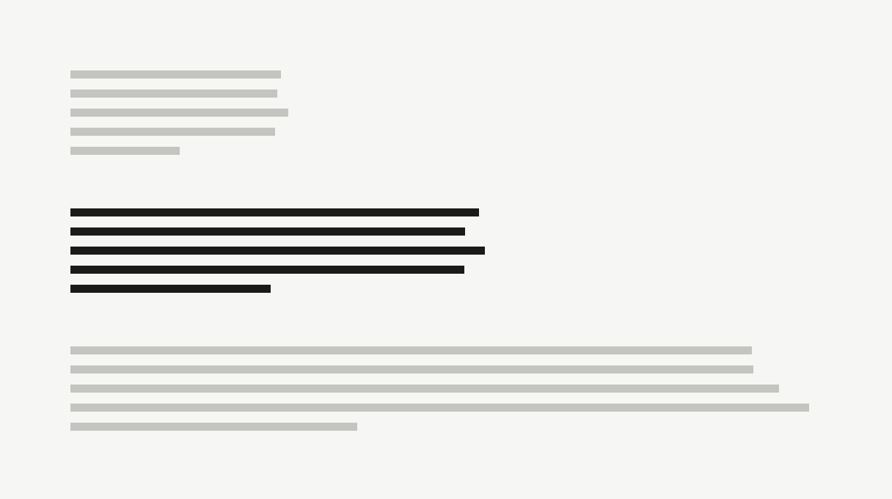

Open a page written in 1996 and it still works. The lines run a little too long, the links are a startling blue, and the headings are bigger than they need to be — but you can read it. Nothing loads in late, nothing moves, nothing asks for your attention except the words.

Most of what the web added since then has served something other than reading. This blog goes the other way: it keeps the old structure and changes only what the old defaults got wrong.

## What it keeps

- Blue, underlined links. You should never have to guess what is clickable.
- One column. Headings, paragraphs, lists and quotes, in the order they were written.
- No images unless the post needs them.

## What it fixes

Three things, mostly. The _line length_, which on a wide monitor could run past a hundred and fifty characters. The _line height_, which was too tight for long reading. And the _type size_, which was set for screens that were smaller and closer to the eye than ours.

The whole correction fits in a few lines of `CSS`:

```css
body {
  max-width: 38rem;
  margin: 4rem auto;
  padding: 0 1.25rem;
  font: 1.1875rem/1.65 serif;
}
```

> Good typography on the web is mostly subtraction: take away everything that competes with the sentence you are reading.

### A note on measure

A comfortable line holds somewhere between 45 and 75 characters.[^measure] This column is set at `38rem`, which at this size lands close to 70.



That is the whole theme. Everything else is the writing. If you want to see how the rest of it behaves, the post on [line height](/blog/line-height-is-not-a-style-choice/) has a table, and [writing for one column](/blog/writing-for-one-column/) has a header image.

[^measure]: The range comes from Robert Bringhurst’s _The Elements of Typographic Style_, which treats 66 characters as the ideal for a single column of text.
